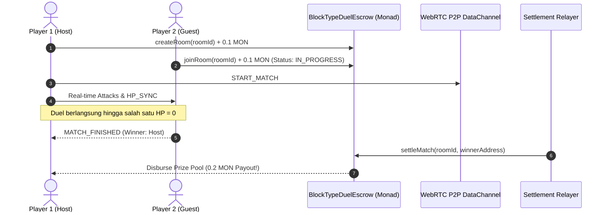

# ⚔️ TypeStrike — 1v1 PvP Typing Arena on Monad


> **Fast-paced 1v1 PvP Web3 Typing Combat Game with Pixel-Art RPG Aesthetics on Monad.**  
> Turn your typing speed, accuracy, and reflexes into deadly projectile attacks! Duel other players in real-time and compete for on-chain Trophy Prize Pools.

[](https://typestrike.vercel.app)
[](https://testnet.monadvision.com)
[](https://soliditylang.org/)
[](https://webrtc.org/)

---

## 🌐 Live Application & Contract Details

- **Live Demo URL:** [https://typestrike.vercel.app](https://typestrike.vercel.app)
- **Repository:** [https://github.com/kurvaParabola/TypeStrike](https://github.com/kurvaParabola/TypeStrike)

### 📜 Deployed Smart Contract (Monad Testnet)

| Parameter | Detail |
|---|---|
| **Contract Name** | `BlockTypeDuelEscrow` |
| **Contract Address** | [`0x54dF67541a74121e0C6179757d22Ea466DdcA994`](https://testnet.monadvision.com/address/0x54dF67541a74121e0C6179757d22Ea466DdcA994) |
| **Network** | Monad Testnet |
| **Chain ID** | `10143` (`0x279f`) |
| **Currency** | `MON` |
| **RPC Endpoint** | `https://testnet-rpc.monad.xyz` |
| **Block Explorer** | [MonadVision](https://testnet.monadvision.com/address/0x54dF67541a74121e0C6179757d22Ea466DdcA994) · [Monad Explorer](https://testnet.monadexplorer.com/address/0x54dF67541a74121e0C6179757d22Ea466DdcA994) |
| **ABI File** | [`abi/BlockTypeDuelEscrow.json`](./abi/BlockTypeDuelEscrow.json) |

---

## 🎮 How to Play (Gameplay Guide)

### 1. Game Modes
- **🥋 Training Dojo (Solo Practice):**
  - Gratis tanpa tiket masuk & tanpa perlu connect wallet.
  - Latihan kecepatan mengetik dan uji kombo senjata melawan Bot AI dengan kecepatan manusiawi.
- **🏛️ Colosseum Ranked (1v1 Arena):**
  - Pertandingan kompetitif resmi 1v1 antar pemain sungguhan.
  - Membutuhkan koneksi Web3 Wallet (MetaMask) di Monad Testnet.
  - Kunci tiket masuk arena (Battle Stake: `0.05 MON`, `0.10 MON`, dll.) ke dalam Smart Contract Escrow. Sang juara membawa pulang 100% dari Trophy Prize Pool (`2x wager`).

### 2. Pilih Hero Class RPG
Setiap gladiator memiliki senjata unik dan pasif bertarung:
- **🗡️ Fighter (Pedang Baja):**
  - *Pasif - Iron Will:* HP dasar tertinggi (120 HP). Sangat tangguh menahan gempuran kata.
  - *Senjata:* Melemparkan tebasan pedang tajam setiap kata selesai diketik.
- **🔮 Wizard (Orb Arkana):**
  - *Pasif - Arcane Surge:* Critical strike berpeluang melipatgandakan damage hingga 2.2x.
  - *Senjata:* Menembakkan bola sihir ungu bercahaya.
- **🏹 Rogue / Archer (Panah Elemental):**
  - *Pasif - Shadow Dodge:* 15% peluang pasif untuk menghindar (*dodge*) dari proyektil lawan tanpa terkena damage sama sekali!
  - *Senjata:* Meluncurkan panah kilat berkecepatan tinggi.

### 3. Mekanik Pertarungan Kata
1. **Kecepatan Menentukan Damage:**
   - Mengetik kata di bawah 400ms = **LEGENDARY CRIT (30+ DMG)**.
   - Mengetik kata di bawah 700ms = **SWIFT STRIKE (20+ DMG)**.
   - Kata biasa = **NORMAL HIT (12–15 DMG)**.
2. **Animasi Proyektil Huruf Terbang:**
   - Setiap huruf yang kamu ketik langsung terbang menyerang avatar lawan secara visual!
3. **🔥 Mode Rage Comeback (< 30% HP):**
   - Saat HP-mu sekarat di bawah 30%, kata-kata buff darurat terbuka:
     - `+25 HP`: Kata pemulihan darah instan.
     - `PERISAI`: Memblokir 1 serangan lawan berikutnya secara total.
     - `DOUBLE DMG`: Menggandakan daya rusak serangan berikutnya.

### 4. Sistem Multiplayer P2P Room
- **Host Room:** Klik *Buat Room*, tentukan tiket masuk MON, lalu salin **Kode Room** (contoh: `MON-4582`) dan bagikan ke temanmu.
- **Guest Player:** Buka tab *Gabung Room*, masukkan kode room dari Host, dan sistem akan langsung menghubungkan browser kalian secara real-time via WebRTC DataChannel bebas delay.
- **Hanya Host yang bisa menekan tombol MULAI DUEL**, sehingga kedua pemain masuk ke arena secara serentak.
- **Hanya 1 Pemenang & 1 yang Kalah:** Konsensus otoritatif menjamin tidak ada lagi skenario kedua pemain menang bersamaan.

---

## 💎 On-Chain Escrow & Payout Flow



---

## 💻 Step-by-Step Setup: Clone to Running Locally

### Prasyarat (Prerequisites)
- [Node.js](https://nodejs.org/) v18.0.0 atau lebih baru
- [Git](https://git-scm.com/)
- [Foundry](https://book.getfoundry.sh/getting-started/installation) *(opsional, untuk build & test smart contract)*
- Ekstensi Browser Web3: [MetaMask](https://metamask.io/) atau Rabby Wallet

---

### 1. Clone Repository
```bash
git clone https://github.com/kurvaParabola/TypeStrike.git
cd TypeStrike
```

---

### 2. Jalankan Frontend (Web dApp)

1. Masuk ke direktori `web`:
   ```bash
   cd web
   ```
2. Install seluruh dependencies:
   ```bash
   npm install
   ```
3. Salin file environment:
   ```bash
   cp .env.example .env
   ```
4. Jalankan development server lokal:
   ```bash
   npm run dev
   ```
5. Buka browser di [http://localhost:5173](http://localhost:5173).

---

### 3. Build & Test Smart Contract (Foundry)

Kembali ke root folder:
```bash
cd ..
```

1. Install dependencies OpenZeppelin & Forge standard library:
   ```bash
   forge install
   ```
2. Kompilasi smart contract:
   ```bash
   forge build
   ```
3. Jalankan unit test (19 test cases):
   ```bash
   forge test -vv
   ```
4. Lihat laporan gas profiling untuk Monad:
   ```bash
   forge test --gas-report
   ```

---

### 4. Tambahkan Jaringan Monad Testnet ke MetaMask

Jika ingin menguji transaksi on-chain secara lokal:
- **Network Name:** Monad Testnet
- **RPC URL:** `https://testnet-rpc.monad.xyz`
- **Chain ID:** `10143`
- **Currency Symbol:** `MON`
- **Block Explorer:** `https://testnet.monadvision.com`

---

## 🏗️ Tech Stack

| Layer | Teknologi |
|---|---|
| **Frontend Framework** | [React 19](https://react.dev/), [TypeScript](https://www.typescriptlang.org/), [Vite](https://vitejs.dev/) |
| **Styling & UI** | [Tailwind CSS](https://tailwindcss.com/), Pixel Typography (VT323, Press Start 2P), Lucide Icons |
| **Multiplayer Sync** | [PeerJS](https://peerjs.com/) (WebRTC DataChannel P2P low latency) |
| **Web3 & Blockchain** | [Viem](https://viem.sh/), EIP-1193 MetaMask Provider |
| **Smart Contract** | [Solidity 0.8.20](https://soliditylang.org/), [OpenZeppelin](https://openzeppelin.com/) ReentrancyGuard & Ownable |
| **Development Tooling** | [Foundry](https://getfoundry.sh/) (Forge, Cast) |
| **Hosting & Deployment**| [Vercel](https://vercel.com) |

---

## 🔒 Security & Fair Play
- **Anti-Reentrancy:** Seluruh fungsi perpindahan dana `createRoom`, `joinRoom`, `cancelRoom`, dan `settleMatch` dilindungi oleh OpenZeppelin `nonReentrant`.
- **Checks-Effects-Interactions:** Status room diubah menjadi `FINISHED` dan saldo nol sebelum koin MON ditransfer ke pemenang.
- **Authoritative Resolution:** Transaksi pencairan smart contract diverifikasi secara kriptografis sehingga saldo tidak dapat diklaim dua kali (*double-spend protection*).
- **Consensus P2P:** Protokol pertarungan WebRTC mengunci state pemenang secara tunggal demi menjamin kepastian mutlak (1 juara, 1 kalah).

---

## 👥 Tim & Pengembang
- **GitHub:** [@kurvaParabola](https://github.com/kurvaParabola)
- **Project Repository:** [TypeStrike](https://github.com/kurvaParabola/TypeStrike)

---

## 📄 Lisensi
Proyek ini dilisensikan di bawah lisensi **MIT**. Bebas dikembangkan dan dimodifikasi untuk ekosistem Monad.
